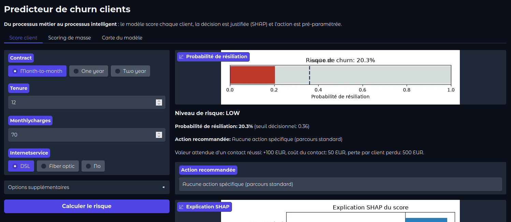
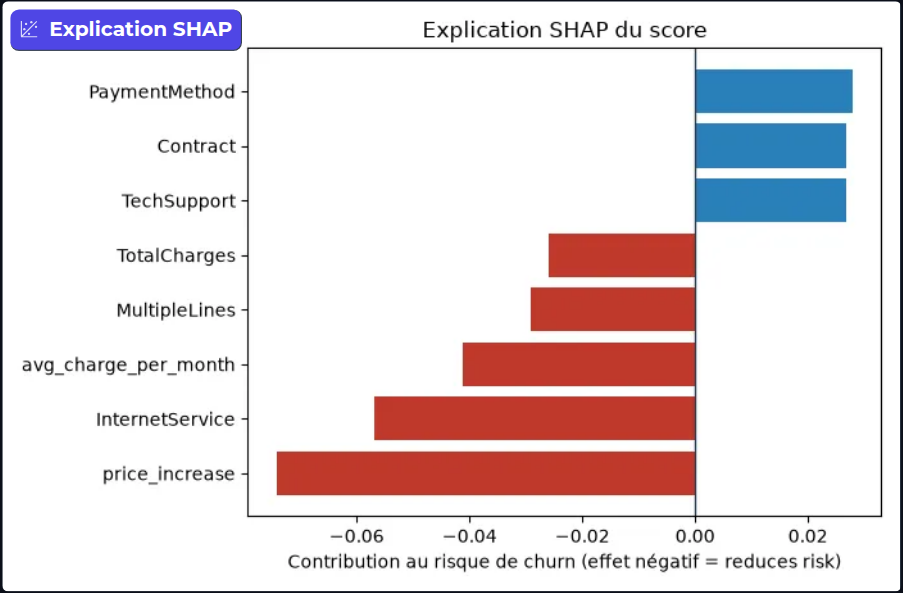
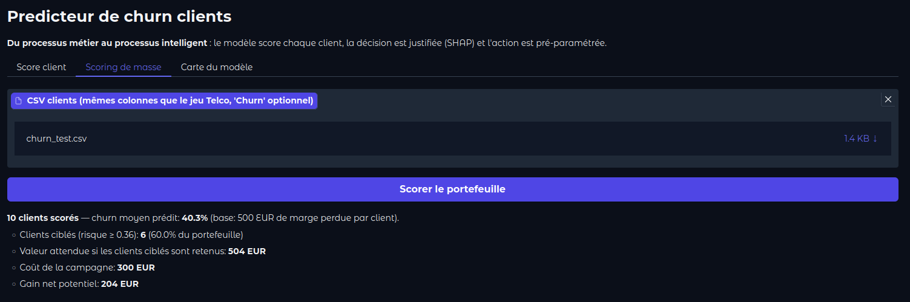
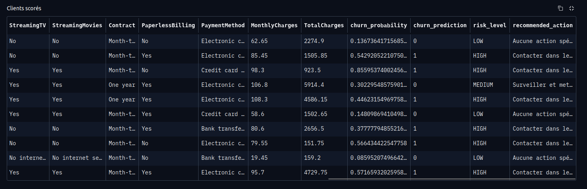

# churn-pred

Customer churn prediction, structured as a production-ready ML project.

The notebook is the workshop, not the product: all business logic lives in
`src/churn_pred/`, `notebooks/` only imports from it.

## Demo

The Gradio app scores a customer, thresholds the decision on the economic
break-even, batch-scores a portfolio and justifies every score with SHAP
(`make serve`, then http://localhost:7860).

**Score client** — churn probability as a gauge against the decision threshold
(0.36), risk level, and the pre-parametrised action with its business value.



**Explication SHAP** — per-client feature contributions in probability points,
so the commercial can act on *why*.



**Scoring de masse** — upload a CSV (e.g. `data/sample_clients.csv`):



Result: scored table with probability / risk level / recommended action, plus
the net gain estimate for the targeted campaign (+204 EUR for the 10 test
clients).



All screenshots live in [`screenshots/`](screenshots/).

## Layout

```
churn-pred/
├── src/churn_pred/        # code that ships
│   ├── config.py          # paths and constants
│   ├── telco.py           # Telco business logic: cleaning, features, model, threshold, SHAP
│   └── app.py             # Gradio app: customer scoring, batch scoring, model card
├── scripts/               # CLI entry points
│   └── train_telco.py     # trains the Telco churn model
├── notebooks/             # exploration only, imports from src/
│   └── 01_churn_experimentation.ipynb
├── tests/                 # pytest suite
├── data/
│   ├── 01_raw/            # immutable (Telco CSV, user must provide)
│   │   └── WA_Fn-UseC_-Telco-Customer-Churn.csv
│   ├── sample_clients.csv # 10-client file to try batch scoring in the app
│   └── .gitkeep
├── models/                # serialized bundles (joblib)
├── artifacts/             # metrics, reports
├── docs/                  # business docs (see docs/README.md)
├── Dockerfile
├── Makefile
└── pyproject.toml         # single source of truth for dependencies
```

## Setup

```bash
uv sync --dev --all-extras
uv run pytest -q
```

The `server` extra (gradio, shap) is only needed for training and serving.

## Telco churn: train, then serve

1. Put the Telco CSV at `data/01_raw/customer_data.csv`
   (kaggle dataset *Telgo Customer Churn*).
2. Train:

   ```bash
   make train   # name/costs are overridable, see Makefile
   ```

   This writes `models/churn_pipeline.joblib` (the full bundle: pipeline,
   threshold, business context, background sample) and
   `artifacts/churn_metrics.json`.

3. Serve locally with Gradio (next section), or in Docker:

   ```bash
   make docker-build
   make docker-serve   # mounts ./models as read-only
   ```

## Testing with Gradio locally

Start the app:

```bash
make serve          # runs: uv run churn-gradio --host 0.0.0.0 --port 7860
```

Then open http://localhost:7860 — three tabs:

1. **Score client** — fill in contract, tenure, services, charges; the app
   calls `telco.predict_row`, and shows the churn probability (gauge), the
   decision (target/not target given the economic threshold) and the three
   features that push the risk up or down (local SHAP).
2. **Scoring de masse** — upload a CSV of customers: `data/sample_clients.csv`
   is a 10-row example that matches the raw column names (no `Churn` column),
   usable as a drop-in test. The app downloads a scored CSV.
3. **Carte du modèle** — key metrics, business context and global SHAP bars,
   for the model review.

Typical local end-to-end test, less than 2 minutes:

```bash
make train-telco && make serve
# browser: test the 10 clients in data/sample_clients.csv in the "Score client"
# tab (lowest tenure tend to score highest), then run "Scoring de masse"
```

Optional heads-up checks without the browser:

```bash
curl -s -o /dev/null -w '%{http_code}\n' http://localhost:7860
```

If `models/churn_telco_pipeline.joblib` is missing, the CLI fails fast with a
message telling you to run `make train-telco`.

## Colab / notebook workflow

`notebooks/01_churn_experimentation.ipynb` runs in a single pass: data quality,
EDA, leakage-free feature engineering, model comparison (CV), economic
threshold, SHAP, artifact export, and a one-cell Gradio smoke test. On Colab it
bootstraps the project code (zip upload or pip from GitHub); locally the venv
already has everything — see `notebooks/README.md`.

## Conventions

- ruff (line length 100, rules E,F,I,UP,B): `make lint`
- format: `make format`
- tests: `make test`
- CI runs lint + format check + pytest.

